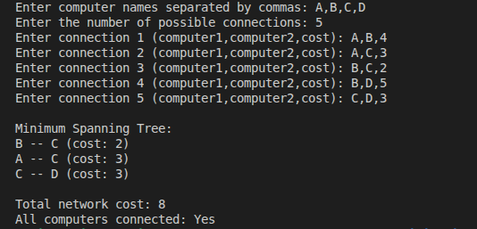
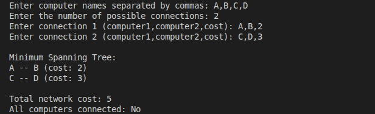
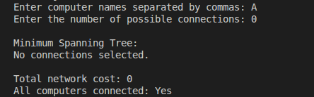

# GMC Network Cable Optimization

## Overview

This project implements Kruskal's algorithm to find the Minimum Spanning Tree (MST) of a computer network.

The objective is to connect a set of computers using the available connections while minimizing the total connection cost.

The network is represented as a weighted, undirected graph:

- **Vertices:** The computers in the network.
- **Edges:** The possible connections between computers.
- **Weights:** The cost of establishing each connection.

The program selects the connections that minimize the total cost while connecting all computers, provided the network allows it.

## Algorithm

### Kruskal's Algorithm

Kruskal's algorithm finds a Minimum Spanning Tree by selecting edges in increasing order of weight.

The algorithm follows these steps:

1. Sort all possible connections by increasing cost.
2. Start with an empty Minimum Spanning Tree.
3. Consider each connection, beginning with the cheapest.
4. Add the connection if it does not create a cycle.
5. Stop when the tree contains `V - 1` edges, where `V` is the number of computers.

If the graph is disconnected, it is not possible to connect every computer using the available connections.

### Union-Find

The implementation uses a Union-Find data structure to determine whether adding a connection would create a cycle.

It uses two operations:

- **Find:** Identifies the set to which a computer belongs.
- **Union:** Combines two sets when a connection joins them.

Path compression and union by rank improve the efficiency of these operations.

## Features

- Represents computers as vertices and connections as weighted edges.
- Implements Kruskal's algorithm.
- Uses Union-Find to detect cycles.
- Displays the selected connections and their individual costs.
- Calculates the total network cost.
- Reports whether all computers are connected.
- Allows users to enter computers, connections, and weights through the terminal.

## Tests

### All computers can be connected

### Some computers cannot be connected

### Only one computer

